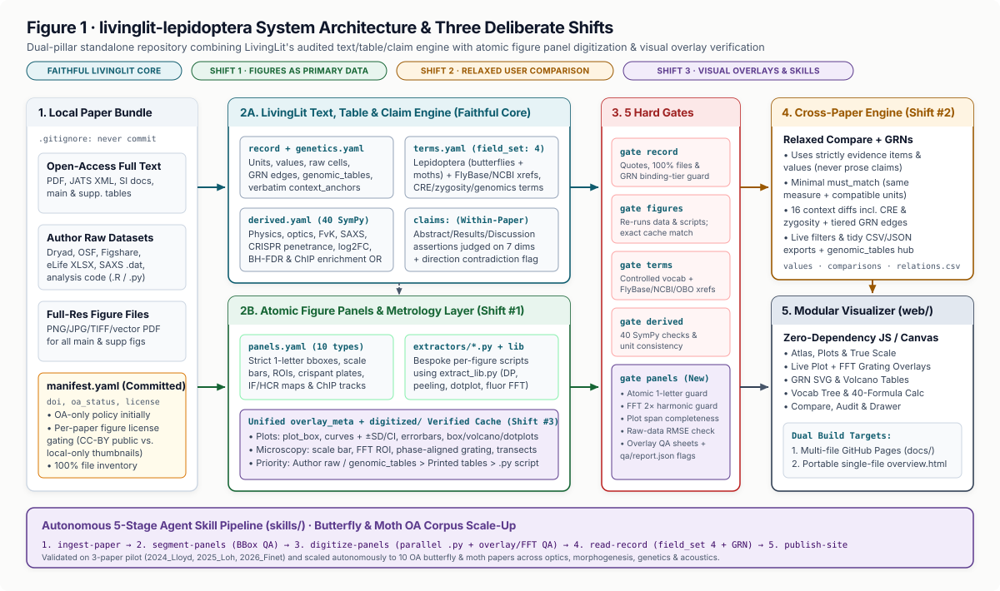

# `livinglit-lepidoptera`

A standalone, audited living literature review & digitized figure atlas for **Lepidoptera (butterflies and moths)** — spanning scale morphogenesis, ultrastructure, biophotonics, and extensible functional directions (moth acoustics, pigments, thermal/wetting mechanics, and macro wing patterning).

Built on LivingLit's assumption-free epistemic core (anchored verbatim quotes, raw author data tables, SymPy formula verification, 7-dimension within-paper claim auditing, and deterministic verification gates), extended with **atomic 1-letter figure panel segmentation**, **bespoke per-figure Python digitization**, **phase-aligned microscopy FFT grating overlays**, **relaxed user-discretion cross-paper comparison**, and an **autonomous 5-stage agent skill pipeline**.

## Design Specification (`docs/design/`)

| Document | Scope |
|---|---|
| [00 · Overview & Architecture](docs/design/00-overview.md) | Vision, Lepidoptera scope, faithful LivingLit pillars vs. the 3 deliberate shifts, repo layout, OA license policy |
| [01 · Record, Vocabulary & Schema](docs/design/01-record-and-schema.md) | `manifest.yaml`, `record.yaml`, `data.yaml`, `field_set: 3` (butterflies + moths + extensible traits), ontology xrefs, and Claim vs. Evidence rules |
| [02 · Atomic Panels, Digitization & Overlays](docs/design/02-panels-and-digitization.md) | Strict 1-letter panel splits, data hierarchy, `extract_lib.py`, per-figure `extractors/*.py`, unified Plot + Microscopy FFT `overlay_meta`, automated gate guards |
| [03 · Within-Paper Audit & Formulas](docs/design/03-audit-and-formulas.md) | SymPy derivation library, printed vs. data vs. digitized checks, 7-dimension claim verdicts, `claim_direction_flags`, suspected-error discipline |
| [04 · Relaxed Cross-Paper Comparison](docs/design/04-across-sources.md) | Strictly empirical comparisons (`evidence` items & `values` only), minimal physical blockers, transparent context diffs, interactive user discretion, Knowledge Graph |
| [05 · Autonomous Agent Skill Pipeline](docs/design/05-autonomous-skill-pipeline.md) | 5-stage `skills/` workflow (`ingest-paper` → `segment-panels` → `digitize-panels` → `read-record` → `publish-site`), visual self-verification loops, `qa/report.json`, 2-paper pilot plan |
| [06 · Visualizer, Releases & CI](docs/design/06-visualizer-and-releases.md) | Zero-dependency modular `web/` architecture (GitHub Pages `docs/` + portable `overview.html`), live Plot + FFT overlay viewer, `.py` code viewer, CI gates |

## Attribution & License

Released under the [MIT License](LICENSE). Derived from and adapted from `livinglit` (Copyright © 2026 Emma Lejeune). Source paper PDFs, raw third-party archives, and external ontology dumps are strictly `.gitignore`d and never committed.
