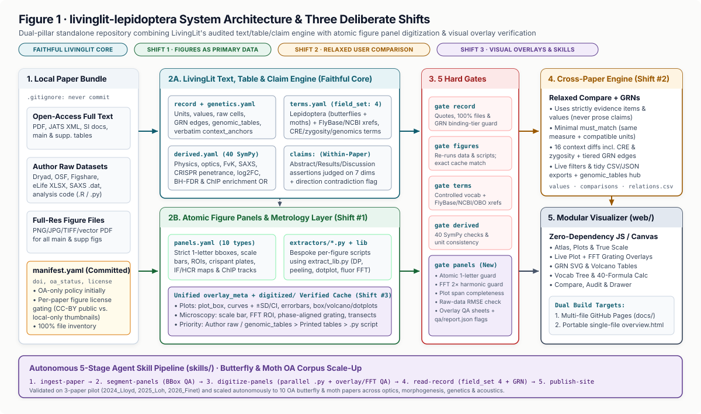

# 00 · Overview & System Architecture

## 1. Mission & Scientific Scope

`livinglit-lepidoptera` is a standalone, reproducible literature infrastructure for **Lepidoptera (butterflies and moths)**. Its goal is to put **every empirical number, raw dataset, digitized figure curve, calibrated micrograph, and audited claim** from open-access Lepidoptera literature at a researcher's fingertips — with **zero baked-in theoretical assumptions** and **complete visual and computational verifiability**.

- **Core initial domain**: Wing and body scale morphogenesis, evo-devo genetics & functional genomics (CRISPR G0 mosaics, RNAi knockdowns, hierarchical `target_gene` FlyBase/NCBI orthologs, anchor-backed directed Gene Regulatory Networks in `genetics.yaml`, snRNA-seq/ChIP-seq `genomic_tables`), cytoskeletal/cuticular development (actin bundles, chitin, drug perturbations), 2D/3D scale ultrastructure (ridges, cross-ribs, lamellae, gyroids, honeycombs, lower-lamina thin films), and biophotonics (angle-resolved reflectance, SAXS, FDTD/thin-film optics).
- **Explicit extensibility for additional Lepidoptera directions**: The `field_set: 4` vocabulary and schema leave clean, first-class room for **moth acoustic scales** (broadband ultrasonic metamaterial absorbers on wings and thorax), **pigment chemistry** (melanins, ommochromes, pterins, papiliochromes, bile pigments), **thermal/radiative and wetting mechanics**, and **macro wing-pattern evo-devo** (coding exons, cis-regulatory elements, and lncRNAs/miRNAs), without forcing new papers into rigid ad-hoc notes.



---

## 2. What Stays Faithful to Original LivingLit vs. Three Deliberate Shifts

`livinglit-lepidoptera` preserves the epistemic foundation of upstream LivingLit while making **three explicit structural and ideological adaptations** for comparative Lepidoptera science:

### Five Pillars Kept 100% Faithful to Upstream LivingLit
1. **Zero invented numbers or interpretive prose**: Every stored datum — including every directed regulatory edge in `genetics.yaml` — traces directly to a verbatim paper quote (`≤30 words`, verified against extracted text), an exact author data cell (`data.yaml`), or deterministic extraction code re-executed on every gate.
2. **Strict data-source hierarchy**: Author raw repository data (`Tier 1`, including supplemental DE/ChIP/morphometric `genomic_tables`) > printed tables and text (`Tier 2`) > code-extracted figure readings (`Tier 3`). Suspect author numbers are preserved verbatim and marked `suspect` / `suspected_error` — never silently corrected or dropped.
3. **Code computes all checks, formulas, and directions**: SymPy derivation checks (`derived.yaml`, 40 physics + morphometrics + genetics/CRISPR/genomics formulas), values-computed effect directions (`across.py`), GRN binding-assay `evidence_tier` guards (`gate_record.py`), and 7-dimension within-paper claim verdicts (`audit.py`).
4. **Controlled vocabulary + `context_anchors` + `other_conditions`**: Unstated conditions remain `not stated`; novel experimental conditions go cleanly into `other_conditions` rather than being distorted into an ill-fitting field.
5. **Per-figure extraction code**: Figure-specific logic lives strictly inside `records/<paper>/extractors/*.py` (never hacked into core `src/`).

### Three Deliberate Shifts in `livinglit-lepidoptera`

| # | Dimension | Original LivingLit | `livinglit-lepidoptera` | Rationale |
|---|---|---|---|---|
| **1** | **Role of figures & genetic plates** | Fallback audit tool (*"points or nothing"*); skips curves, boxplots, heatmaps, and microscopy images. | **Primary empirical layer**: atomic 1-letter segmentation (`panels.yaml`) with 10 archetypes (including `crispant_phenotype_plate`, `expression_imaging`, `expression_matrix`, `genomic_track_or_locus`), bespoke `.py` digitization for spectra, `±SD`/CI bands, errorbars, boxplots, snRNA-seq dotplots, volcano plots, and calibrated SEM/TEM/confocal/STED 2D-FFT metrology. | In Lepidoptera morphogenesis, optics & evo-devo, continuous spectra, PGLS plots, crispant wing plates, HCR/IF channels, ChIP tracks, expression matrices, and calibrated micrographs *are* the primary quantitative record. |
| **2** | **Cross-paper standing keys & GRNs** | Strict `must_match` hard-blocks comparisons (`not comparable`) whenever required context differs. | **Relaxed, user-discretion comparison + Evidence-Tiered GRN**: hard-blocks only on physical incompatibility (different measure or incompatible units); surfaces all 16 biological/genetic/methodological differences (`genetic_element_type`, `allele_or_zygosity`, orientation, prep) as interactive diff badges, while synthesizing anchor-backed directed regulatory edges (`genetics.yaml`) styled by `evidence_tier`. | Lepidoptera research is inherently comparative across species, clades, genes, scale types, and stages; researchers should exercise explicit scientific discretion rather than hit hidden walls. |
| **3** | **Verification & ingestion** | Manual `/tmp` render checks + human-driven reader runs. | **Unified geometric `overlay_meta`** (plots, dotplot matrices, AND microscopy scale-bar/ROI/phase-aligned FFT gratings) + **autonomous 5-stage Agent Skill Pipeline (`skills/`)** with self-closing visual-QA loops and automated harmonic/completeness/binding-tier guards. | Enables scalable, autonomous ingestion of new papers without silent curve, harmonic, or over-claimed GRN defects after the initial human-reviewed pilot. |

---

## 3. Standalone Repository Layout

```text
livinglit-lepidoptera/
├── LICENSE                       # MIT (preserving upstream livinglit attribution)
├── README.md
├── pyproject.toml                # Package: livinglit-lepidoptera (CLI: livinglit-lep)
├── .gitignore                    # Strictly excludes papers_dont_ever_commit/, raw data, caches
├── docs/
│   ├── design/                   # Numbered design specification (00..06) + figures/*.svg,.png
│   └── site/                     # Built multi-file static site (GitHub Pages ready)
├── fields/lepidoptera/
│   ├── field.yaml                # Extensible Lepidoptera context fields (field_set: 4, 16 fields)
│   ├── changes.yaml              # Append-only vocabulary log (v3: 236 terms, FlyBase/NCBI xrefs)
│   ├── vocab.yaml                # Rebuilt hierarchical vocabulary + relaxed standing keys
│   └── formulas/                 # 40 SymPy physics, morphometrics, CRISPR & genomics formulas
├── src/livinglit_lepidoptera/
│   ├── models.py                 # Pydantic v2 strict models (Record, GeneticsFile, Panel, Manifest)
│   ├── extract_lib.py            # Shared CV/DP/matched-filter/FFT primitives (zero figure hardcoding)
│   ├── panels.py                 # Atomic panel runner, genetic metadata cards, automated gate guards
│   ├── qa_overlays.py            # Full-figure BBox sheets, Plot overlays, Microscopy FFT grating sheets
│   ├── gate_*.py                 # 5 deterministic gates (record + genetics tier guard, figures, terms, derived, panels)
│   ├── audit.py                  # Within-paper numeric/formula/claim audit engine
│   ├── across.py                 # Relaxed cross-paper comparison & transparent context diffs
│   ├── harvest.py                # Author repository, code & schema-driven genomic_tables bundler
│   ├── release.py                # Tidy release builder (values.csv, comparisons.csv, relations.csv, terms.csv)
│   └── cli.py                    # Unified CLI entrypoint
├── skills/                       # Autonomous 5-stage Agent Skill Pipeline
│   ├── add-paper/SKILL.md        # Top-level orchestrator skill
│   ├── ingest-paper/SKILL.md
│   ├── segment-panels/SKILL.md
│   ├── digitize-panels/SKILL.md
│   ├── read-record/SKILL.md
│   └── publish-site/SKILL.md
├── readers/                      # Lepidoptera-native reader instructions & checklists
├── web/                          # Zero-dependency modular HTML/CSS/JS visualizer (Atlas, Plots, True Scale, Compare, Audit, GRN & Graph, Vocab & Formulas, Papers)
├── records/<paper>/              # One self-contained directory per paper
│   ├── manifest.yaml             # DOI, OA status, license, figure_embed_policy, file inventory
│   ├── record.yaml               # Text/table/supplement values, units, groups, items, claims
│   ├── genetics.yaml             # Optional: anchor-backed directed GRN edges + genomic_tables specs
│   ├── data.yaml                 # Exact cells mapped from author raw files
│   ├── terms.yaml                # Controlled vocabulary mappings
│   ├── derived.yaml              # Formula checks
│   ├── readings.yaml             # Checked figure readings feeding evidence items
│   ├── panels.yaml               # Atomic 1-letter panel manifest (zero composites, 10 archetypes)
│   ├── resources.yaml            # Linked repos, scripts, & raw archives
│   ├── extractors/*.py           # Bespoke per-figure Python digitization scripts
│   ├── digitized/                # Reproducible checked cache (panels_extracted.json, series.csv)
│   └── qa/report.json            # Per-panel confidence grades, RMSE, harmonic & retry audit log
├── releases/                     # Versioned release snapshots
├── tests/                        # Unit tests (extract_lib, genetics binding guard, gates, web build)
└── .github/workflows/ci.yml      # Runs pytest + all N×5 paper gates + web build check
```

---

## 4. Repository Visibility & Open-Access Policy

- **Current visibility**: Private GitHub repository during development and pilot validation; structured to transition cleanly to public + GitHub Pages with zero refactoring.
- **Open-access-only ingestion policy (initial phase)**: Only open-access papers (`CC-BY`, `CC0`, or publisher OA permitting reuse) are ingested until a future policy decision covers restricted/paywalled literature.
- **Built-in forward-compatible license gating**: Every paper's `manifest.yaml` declares `oa_status`, `license`, and `figure_embed_policy: public_thumbnails | local_only`. Source PDFs and full-resolution figures always stay inside `.gitignore`d `papers_dont_ever_commit/`.
