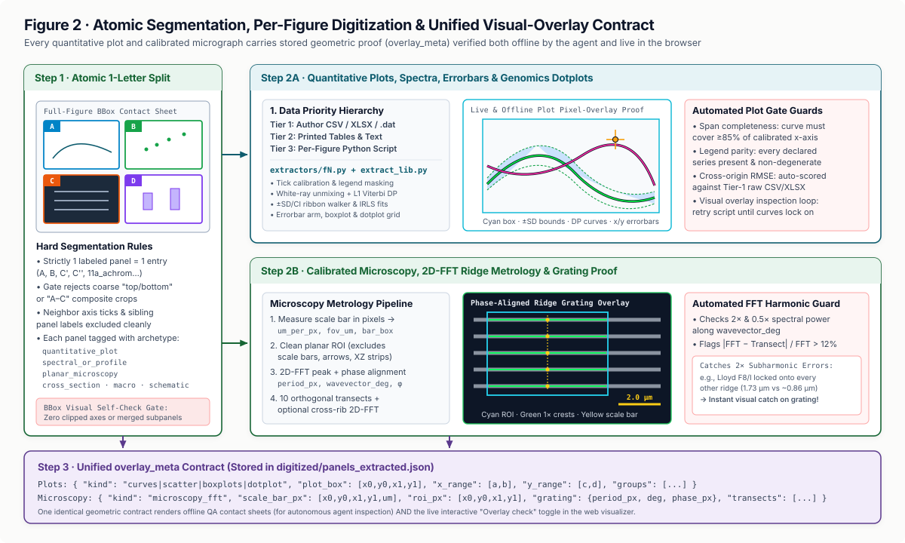

# 02 · Atomic Figure Panels, Per-Figure Digitization & Visual-Overlay Contract

This document defines **Shift #1** (treating figure panels and microscopy images as primary empirical data) and the core verification mechanism of **Shift #3** (mandatory geometric `overlay_meta` proof for both plots and microscopy).



---

## 1. Strict Atomic 1-Letter Panel Segmentation (`panels.yaml`)

Prototype audits showed that coarse `top`/`bottom` or `A–C` composite crops silently hide quantitative subplots, distort scale-bar detection, and break side-by-side browsing. `livinglit-lepidoptera` enforces **strict atomic decomposition**:

1. **One labeled sub-panel = one `panels.yaml` entry**: Every lettered panel (`A`, `B`, `C'`, `C''`, `11a_chrom`, `11a_achrom`) gets its own tight pixel bounding box `[x0, y0, x1, y1]`, excluding neighboring axis ticks and sibling panel labels.
2. **Automated composite-panel guard (`gate panels`)**: Fails if a `panel_id` or `panel_label` uses composite patterns (`top`, `bottom`, `left`, `right`, `A–C`, `C–D`, `I–J`, `AB`, `CD`) unless explicitly whitelisted with `composite_justification` (e.g., an inseparable stereo pair or indivisible sequential time-lapse strip sharing one shared axis).
3. **Full-Figure BBox Contact Sheet**: Every segmentation pass renders every full source figure with labeled colored bounding rectangles. The agent visually inspects every contact sheet before proceeding to digitization.
4. **Panel archetypes**:
   - `quantitative_plot` (scatter, regression, errorbar, boxplot, violin, bar, dotplot matrix, volcano)
   - `spectral_or_profile` (continuous reflectance/Raman/SAXS/FDTD curves, AFM/height transects, ChIP/coverage tracks)
   - `planar_microscopy` (top-down/whole-mount SEM, SIM, confocal, optical — eligible for 2D-FFT ridge/cross-rib metrology and True-Scale Comparison)
   - `cross_section` (FIB-SEM, TEM, XZ orthogonal sections — eligible for scale-bar calibration & layer thickness measurement)
   - `macro_morphology` (whole wing / specimen photographs)
   - `phylogeny_or_schematic` (cladograms, regulatory circuits, optical schematics)

---

## 2. Data-Source Hierarchy (Never Overwrite Ground Truth With Pixels)

| Priority | Source | Rule |
|---|---|---|
| **Tier 1** | Released author raw data (Figshare/OSF/Dryad/eLife CSV/XLSX/SAXS `.dat`) | Parsed directly into `data.yaml` / `data_hub.json`. If the figure also plots this data, digitized curves are cross-checked against Tier 1 and the **RMSE is logged** in `qa/report.json`. |
| **Tier 2** | Printed tables and text numbers | Anchored verbatim in `record.yaml` (`origin: stated`). |
| **Tier 3** | Bespoke per-figure Python extraction (`records/<paper>/extractors/<fig>.py`) | Used for every plotted series, ribbon, errorbar, boxplot, dotplot, and microscopy measurement not available in Tier 1/2. |

---

## 3. Shared Primitives (`extract_lib.py`) + Bespoke Per-Figure Extractors

Generic declarative YAML specs (`curve_spec`, `scatter_spec`) repeatedly failed on crossing curves, steep reflectance peaks, arrowheads, overlapping errorbars, and closely spaced range bars. In `livinglit-lepidoptera`, **all non-trivial quantitative figures use bespoke, auditable Python scripts** built on a unit-tested shared toolkit:

### `src/livinglit_lepidoptera/extract_lib.py` (Zero Figure-Specific Hardcoding)
- **Axis & tick calibration**: linear and log-axis tick mapping (`lin_range`, `log_range`), automatic frame box detection, legend/inset masking.
- **Color decomposition**: perpendicular distance & ink-opacity $\alpha$ along the white-to-target RGB ray (`ray_dist_alpha`), cleanly separating dark core lines from translucent same-hue `±SD` ribbons.
- **L1-penalty Viterbi dynamic programming (`viterbi_track`)**: tracks continuous curves through crossings and steep 50–80% reflectance peaks without quadratic slope flattening, with inter-trace hue repulsion and optional verified peak anchors.
- **Ribbon envelope walker (`walk_ribbon_bounds`)**: walks continuously upward/downward from the tracked mean curve across shaded `±SD` or `95% CI` bands without jumping to frame tick marks.
- **Robust regression & CI fitter (`fit_irls_line_and_ci`)**: fits straight OLS lines + smooth quadratic 95% CI envelopes directly from plotted `ggplot2`-style translucent ribbons while ignoring overlapping scatter dots.
- **Discrete feature detectors**: connected-component blob finder with red-bar dot healing (`beeswarm_1d`), radiating error-bar arm walker (`trace_error_arms` for `x_lo/x_hi/y_lo/y_hi`), contiguous vertical stem-run bar detector (`extract_vertical_bars`), violin/boxplot IQR+whisker detector, and colorbar-calibrated dotplot matrix reader.
- **Microscopy metrology (`measure_periodic_fft`, `measure_transects`, `check_fft_harmonics`)**:
  - Calibrates `um_per_px` and `fov_um` from the panel's scale-bar bracket (`scale_bar_px`).
  - Computes 2D-FFT dominant spatial frequency (`periodic_fft_um`), orientation (`wavevector_deg`), SNR, **exact spatial phase shift** $\phi$ (so overlay grating lines land dead-center on bright ridge crests!), and 10 orthogonal intensity transects (`periodic_transect_um ± sd`, plus per-transect peak coordinates).
  - Optional orthogonal cross-rib 2D-FFT (`crossrib_fft_um`).

### Per-Figure Extractor Interface (`records/<paper>/extractors/<fig>.py`)
Each script exposes one pure, deterministic function:

```python
def extract(
    crop_rgb: np.ndarray,
    panel_id: str,
    *,
    full_rgb: np.ndarray | None = None,
    bbox: tuple[int, int, int, int] = (0, 0, 0, 0),
    fig_id: str = "",
) -> dict[str, Any]:
    """Return any combination of curves, digitized_scatter, digitized_boxplots,
    dotplot_matrix, extracted_data, and mandatory overlay_meta."""
```

Every script is bundled into `data_hub.json` so readers can inspect the exact code behind any panel directly in the browser.

---

## 4. Unified `overlay_meta` Contract (Plots AND Microscopy)

Every digitized plot panel and every calibrated microscopy/FFT panel **must** emit structured `overlay_meta` inside `digitized/panels_extracted.json`. The exact same payload renders both offline QA contact sheets (`qa_overlays.py`) and the live in-browser **`Overlay check`** toggle:

### Quantitative Plot `overlay_meta`
```json
{
  "kind": "curves | scatter | scatter_curves | boxplots | dotplot",
  "plot_box": [px0, py0, px1, py1],
  "x_range": [x_min, x_max],
  "y_range": [y_min, y_max],
  "x_scale": "linear | log10",
  "y_scale": "linear | log10",
  "mode": "scatter_2d | beeswarm_1d | null",
  "groups": [{"name": "control", "x_frac": [0.15, 0.45], "x_val": 0}]
}
```
- **Curves** carry `x`, `y`, optional `lo`, `hi` (`±SD` or `95% CI` ribbon envelopes).
- **Scatter** carries `x`, `y`, optional per-point `x_lo`, `x_hi`, `y_lo`, `y_hi`, or group `x_interval`/`y_interval`.
- **Dotplot matrices** carry per-cell `{cluster, gene, expr, pct, px, py, r_px}` so exact circle outlines project directly over every cell.

### Microscopy / FFT `overlay_meta` *(New — Closes Prototype Verification Gap)*
```json
{
  "kind": "microscopy_fft",
  "scale_bar_px": {"x0": 510, "y0": 680, "x1": 642, "y1": 680, "um": 2.0, "um_per_px": 0.01515},
  "roi_px": [120, 95, 540, 515],
  "grating": {
    "period_px": 59.3,
    "period_um": 0.898,
    "wavevector_deg": 31.2,
    "phase_shift_px": 14.2,
    "snr": 394.9
  },
  "crossrib_grating": null,
  "transects": [
    {"p0": [160, 140], "p1": [490, 340], "peaks_px": [[192, 160], [243, 191]]}
  ]
}
```
When **`Overlay check`** is toggled on a micrograph, the canvas draws:
1. **Yellow scale-bar bracket** with printed `µm` and calibrated `nm/px`,
2. **Cyan FFT ROI box** proving no arrows, scale bars, or cross-section strips contaminate the ROI,
3. **Phase-aligned bright-green parallel grating lines** inside the ROI landing directly on every ridge crest (making a `2×` subharmonic error like hitting every other ridge immediately obvious in 0.5 seconds!),
4. **Optional magenta orthogonal grating** if cross-rib spacing was measured, and
5. **Subtle transect peak ticks** showing the 10 independent spacing measurements.

---

## 5. Automated Gate Guards (`gate panels`)

`livinglit gate panels <paper>` re-executes every extractor and microscopy measurement and fails on any regression or silent defect:

1. **Exact reproducibility check**: Recomputed `panels_extracted.json` and `series.csv` must match the committed `digitized/` cache exactly.
2. **Atomic segmentation guard**: Rejects composite `top/bottom` or multi-letter panel IDs lacking an explicit `composite_justification`.
3. **FFT harmonic & transect consistency guard**:
   - Evaluates 2D-FFT spectral power at $f/2$ and $2f$ along `wavevector_deg`; flags when a harmonic exceeds 60% of the chosen peak without an explicit `harmonic_verified: true` override in `panels.yaml`.
   - Flags any panel where $|d_{\text{FFT}} - d_{\text{transect}}| / d_{\text{FFT}} > 12\%$.
   - Flags low-SNR panels (`snr < 8`) in `qa/report.json` (`status: low_snr_verify`) for visual confirmation of the grating overlay.
4. **Plot completeness guard**: Rejects any traced curve covering `< 85%` of its declared axis span (unless `partial_x_range` is explicitly declared for truncated spectra/contours) or missing a legend series.
5. **Cross-origin raw-data RMSE check**: When a panel links to a Tier-1 raw dataset, automatically computes and logs RMSE between the digitized curve/points and raw author values in `qa/report.json`.
