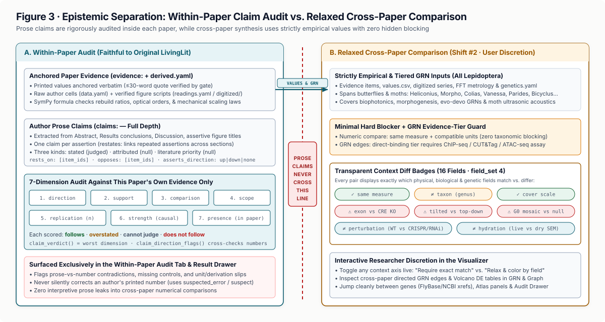

# 04 · Relaxed Cross-Paper Comparison & Epistemic Firewall

This document defines **Shift #2**: keeping cross-paper comparisons **strictly empirical** (zero prose claims, zero hidden interpretive models) while **relaxing rigid standing-key blocking** so researchers exercise explicit discretion across Lepidoptera clades, scale types, developmental stages, and modalities.

---

## 1. The Strict Epistemic Firewall

- **Prose claims NEVER cross into cross-paper comparisons.** All cross-paper plots, tables, comparison verdicts, and intersections operate strictly on empirical `evidence` items, `values.csv`, `data.yaml`, and verified `digitized/` measurements.
- **No baked-in theoretical curves or interpretive thresholds**: The platform never superimposes speculative theoretical thresholds or synthesized narrative conclusions across papers. Researchers export tidy CSV/JSON tables to build whatever theoretical or phylogenetic layer they want on top.

---

## 2. Relaxed Standing Keys (Minimal Physical Blockers + Full Context Transparency)

In upstream LivingLit, strict `must_match` standing keys mark most cross-species or cross-modality pairs as `not comparable` (hard-blocked). In comparative Lepidoptera biology, comparing ridge spacing across *Heliconius*, *Morpho*, *Colias*, *Vanessa*, *Parides*, and moths — or comparing SAXS vs. SEM vs. live SIM — is the core scientific use case.

`livinglit-lepidoptera` therefore adopts a **two-tier relaxed comparison rule**:

### Tier 1 · Minimal Hard Blocker (Strictly Physical / Dimensional)
Two empirical items are eligible for direct numerical comparison whenever:
1. They share the **same canonical `measure`** (e.g., `measure:ridge_spacing`, `measure:peak_reflectance_wavelength`, `measure:ridge_height`, `measure:actin_bundle_spacing`), AND
2. Their units are **dimensionally compatible** (auto-convertible by `numbers.convert`, e.g., `nm` ↔ `µm`) with compatible `expressed_as` basis (`absolute` vs. `% change` / `fold` are never mixed numerically).

### Tier 2 · Transparent Context Diff Surface (User Discretion)
Every eligible cross-paper pair computes an explicit **`context_diff`** across all 13 contextual fields (`taxon`, `sex`, `anatomical_region`, `pattern_element`, `scale_type`, `functional_architecture`, `life_stage`, `pupal_stage_pct`, `target_gene`, `perturbation_modality`, `chemical_agent`, `imaging_modality`, `view_orientation`, `hydration_and_prep`):
- **Matched fields** are shown as green verified pills (e.g., `✓ cover scale`, `✓ adult`, `✓ wild type`).
- **Differing fields** are shown as explicit diff badges (e.g., `≠ taxon (genus)`, `≠ imaging_modality (SAXS vs SEM)`, `≠ perturbation (WT vs Cyto D)`).
- **Known physical confounders get an explicit warning highlight** (not a silent block!), such as `⚠ view_orientation (tilted oblique vs planar apical)` — where foreshortening alters apparent SEM ridge pitch — or `⚠ hydration_and_prep (live hydrated vs vacuum dry SEM)`.
- **Interactive researcher toggles in the UI**: In **Compare → Values** and **Compare → Verdicts**, the user can interactively check/uncheck any context dimension (`Require exact match` vs. `Relax & color by field`) and group distributions by `paper`, `taxon` (phylogenetic DFS order), `functional_architecture`, `scale_type`, or `imaging_modality`.

---

## 3. Effect Direction & Value Agreement (Computed Strictly by Code)

For any two compared items $(A, B)$:
- **Value comparison** (single-group distributions): computes overlap/difference from `group_mean` and `group_sd` (preferring `stated` → `data` → `readings`, and explicitly labeling each value's origin), yielding `agree`, `differ`, or `not available (no spread)`.
- **Direction comparison** (paired perturbations or comparisons): computes each item's direction (`up`, `down`, `none`) strictly from numerical values + printed `p` (falling back to `stated_direction` only when no values exist, explicitly labeled `stated`), yielding `same direction`, `differ in direction`, or `not available`.

---

## 4. "Where Do Papers Meet?" & Knowledge Graph

Every paper meets every other paper across **all shared controlled-vocabulary axes** — not just measures:
- Shared **taxa / clades** (computed along the phylogenetic hierarchy so *H. erato* and *H. melpomene* meet at `Heliconius` and `Nymphalidae`)
- Shared **scale types** & **functional architectures**
- Shared **target genes**, **perturbations**, & **chemical agents**
- Shared **imaging/optical modalities** & **measures**

Both the **Intersection Matrix** (`Compare → Where Papers Meet`) and the dedicated **Knowledge Graph** tab are 100% deterministically computed from `terms.yaml` and `values.csv` with clickable drill-down into exact evidence items and figure panels.
