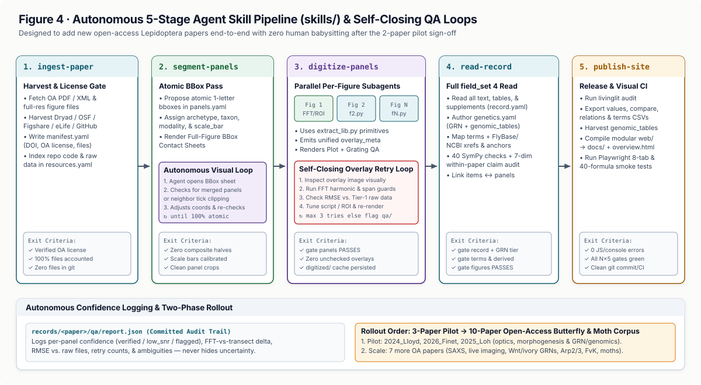

# 05 · Autonomous 5-Stage Agent Skill Pipeline (`skills/`)

This document defines **Shift #3**: turning paper ingestion from ad-hoc prototype scripting into a **deterministic, autonomous, self-verifying agent skill pipeline** that requires zero human babysitting once validated on our initial 2-paper pilot.



---

## 1. Design Principle: Autonomous Self-Closing Loops

After the initial human review of the 2-paper gold-standard pilot, adding a new open-access Lepidoptera paper must run **autonomously from DOI/folder to published visualizer** without silently introducing bad curves, merged panels, or 2× FFT harmonic errors. Every stage therefore pairs **code execution** with a **self-closing verification gate**:

| Stage | Skill | Inputs | Outputs | Autonomous Verification Loop & Hard Exit Criteria |
|---|---|---|---|---|
| **1** | `skills/ingest-paper/SKILL.md` | Paper DOI / URL / local OA folder | `papers_dont_ever_commit/<paper>/` + `manifest.yaml` + `resources.yaml` | Downloads OA PDF/XML, high-res figures, and linked repos (Dryad/OSF/Figshare/eLife/GitHub); verifies OA license; enforces 100% file accounting and zero source files tracked in git. |
| **2** | `skills/segment-panels/SKILL.md` | Full-res figures + captions | Atomic `panels.yaml` + `qa/bboxes_*.png` | Splits every figure into 1-letter panels with 10 archetypes (including `crispant_phenotype_plate`, `expression_imaging`, `expression_matrix`, `genomic_track_or_locus`), `scale_bar` coords, and channel/crispant/locus metadata; renders **Full-Figure BBox Contact Sheets** and iterates until zero merged panels or clipped axis ticks remain. |
| **3** | `skills/digitize-panels/SKILL.md` | `panels.yaml` + full-res figures + Tier-1 raw files | `extractors/*.py` + `digitized/{panels_extracted.json,series.csv}` + `qa/report.json` | **Parallelizable per figure via subagents**: writes bespoke `extractors/fN.py` using `extract_lib.py` (including matched-filter marker peeling, shaded-overlay recovery, dotplot matrices, and fluorescent/SEM 2D-FFT); renders Plot & FFT Grating Overlays; visually inspects every overlay + runs **FFT harmonic, curve span, and raw-data RMSE guards**; retries up to 3× and flags any unresolved ambiguity transparently in `qa/report.json`. |
| **4** | `skills/read-record/SKILL.md` | Full text, tables, SI docs, raw data, `panels.yaml` | `record.yaml`, optional `genetics.yaml`, `data.yaml`, `terms.yaml`, `derived.yaml`, `readings.yaml` | Executes Lepidoptera-native `field_set: 4` reading (all printed values, raw cells, `context_anchors`, `other_conditions`, anchor-backed GRN edges & `genomic_tables`, SymPy formulas, full 7-dim within-paper claims, panel ↔ item links); loops until all 5 gates (`record` + genetics binding-tier guard, `figures`, `terms`, `derived`, `panels`) print `GATE PASSES`. |
| **5** | `skills/publish-site/SKILL.md` | All `records/*/` | `releases/` + `docs/` + `overview.html` | Runs `audit` → `release` (`values.csv`, `comparisons.csv`, `relations.csv`, `terms.csv`) → `harvest` (including `genomic_tables`) → modular `web/` build → headless Playwright visual & 0-JS-error smoke tests across all 8 tabs & light/dark themes. |

Top-level orchestrator skill **`skills/add-paper/SKILL.md`** chains Stages 1–5 end-to-end with a single invocation.

---

## 2. Autonomous Confidence Logging (`records/<paper>/qa/report.json`)

Because autonomous ingestion must **never hide uncertainty or silently fake precision**, Stage 3 writes a committed, machine-readable `qa/report.json` per paper:

```json
{
  "paper": "2024_Lloyd",
  "n_figures": 8,
  "n_atomic_panels": 87,
  "composite_panels": 0,
  "panels": {
    "2024_Lloyd/F2/F": {
      "method": "custom:extractors/f2_morphometrics.py",
      "overlay_checked": true,
      "span_coverage": 0.98,
      "retries": 1,
      "confidence": "verified"
    },
    "2024_Lloyd/F8/I": {
      "method": "microscopy_fft",
      "overlay_checked": true,
      "fft_um": 0.864,
      "transect_um": 0.851,
      "fft_transect_delta_pct": 1.5,
      "harmonic_guard": "pass",
      "snr": 842.0,
      "confidence": "verified"
    }
  }
}
```

Confidence states (`verified`, `low_snr_verified`, `partial_occlusion`, `flagged_needs_review`) are surfaced right inside the Panel Inspector and Audit views so readers immediately know the exact provenance and QA status of every single number.

---

## 3. Two-Phase Rollout Plan

### Phase A · Gold-Standard Validation Pilot (Completed & Human-Verified)
Three contrasting open-access papers validated end-to-end across all 5 stages:
1. **`2024_Lloyd`** (*Heliconius sara*, *Nature Communications*, CC-BY-4.0) — confocal + SIM + TauSTED + SEM microscopy, actin & ridge 2D-FFT (including fluorescent channel-isolated FFTs), Cytochalasin D perturbation, overlapping scatter + OLS + 95% CI plots, reflectance spectra, beeswarm dotplots, and full claim auditing.
2. **`2026_Finet`** (34 butterfly species + *Bicyclus anynana* + *Morpho didius*, *Current Biology* OA, CC-BY-4.0) — 34-species comparative phylogenetics, 39-scale scatter with per-point `x`/`y` errorbars, PGLS regressions + 95% CI ribbons, FIB-SEM cross-sections & depth-stepped milling, crossing experimental + FDTD reflectance spectra, and full claim auditing.
3. **`2025_Loh`** (*Colias eurytheme*, *PLOS Biology*, CC-BY-4.0) — `field_set: 4` evo-devo genetics & genomics validation: 12 anchor-backed `Dsx`/`Bab`/`ivory` GRN edges (`genetics.yaml`), 2 schema-driven supplemental `genomic_tables` (`DataS6` 87 Bab-bound UVI-DE genes + `DataS10` 170 Fourier inter-ridge scales), 85 atomic panels exercising all 4 genetic archetypes, and 168-cell snRNA-seq dotplot digitization (`F10/B`).

### Phase B · Autonomous Scale-Up to 10-Paper Open-Access Butterfly & Moth Corpus
Scale autonomously via `skills/add-paper` (parallelized across papers) to **10 Open Access Lepidoptera papers** spanning structural biophotonics, cellular morphogenesis, biomechanics, evo-devo genetics/GRNs, and moth acoustic stealth metamaterials:
- Remaining 5 OA seed papers: `2018_Parnell` (*Heliconius* SAXS + reflectance), `2021_McDougal` (*Vanessa cardui* live speckle morphogenesis), `2023_Banerjee` (*Bicyclus anynana* Wnt/Armadillo/fz4/optix CRISPR GRN), `2023_Seah` (*Parides* Arp2/3 + CK-666 honeycomb lattice), and `2024_Totz` (*Vanessa cardui* FvK elastic buckling).
- Plus 2 new OA expansion papers: a landmark **butterfly non-coding/lncRNA CRISPR evo-devo** paper (`ivory` lncRNA bridging `2025_Loh` & `2023_Banerjee` in the GRN!) and a landmark **moth wing/thoracic scale biophysics / ultrasonic acoustic stealth** OA paper bringing moths into the corpus alongside butterflies.
